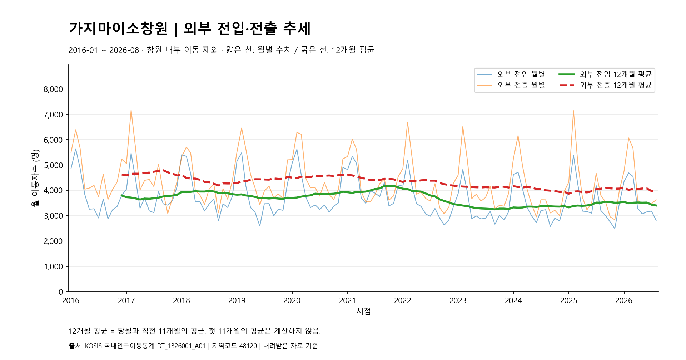
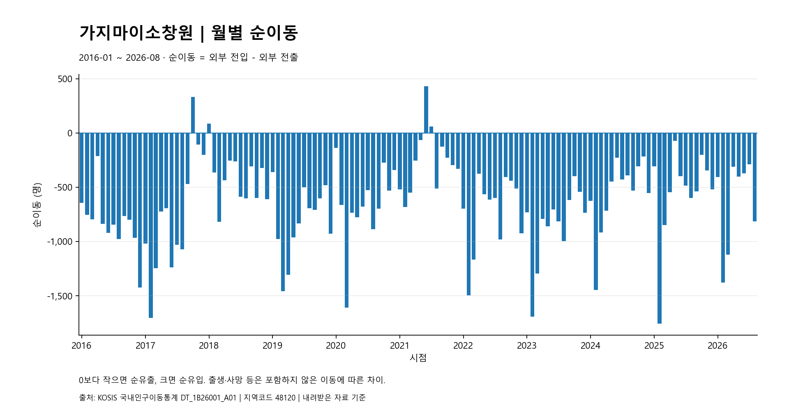
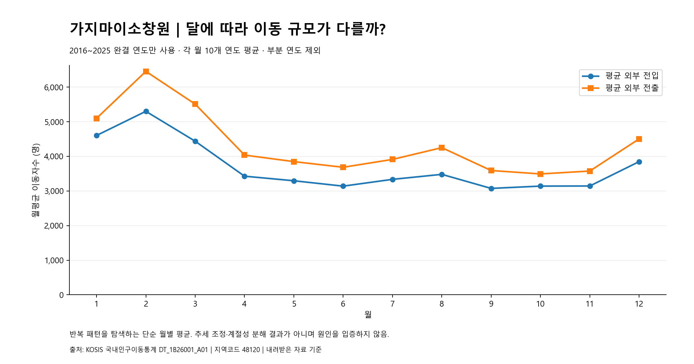

# 가지마이소창원
## 창원시 인구이동 추세 분석과 정착 지원 시사점

> 최종 보고서 초안 · 분석 기간: 2016-01~2026-08 · 대상: 지역코드 48120 창원시
> 기존 결과 CSV, 그래프와 검증 기록을 근거로 작성했다. 이번 보고서 작성에서는 분석 재실행, 코드 수정, 원자료 변경 및 새 그래프 생성을 수행하지 않았다.

## 1. 분석 주제 및 선정 이유

기존 「오이소창원」 프로젝트에서 다뤘던 창원 정착의 문제의식을 이어받아, 이번에는 창원시 인구이동 데이터를 직접 분석한 결과를 살펴본다. 지역 정착을 논의하려면 창원으로 들어오는 이동과 창원을 떠나는 이동이 어떤 규모로 발생하며, 그 차이가 시간에 따라 어떻게 달라지는지 먼저 확인할 필요가 있다.

분석 목적은 특정 서비스의 필요성이나 효과를 미리 결론내리는 것이 아니라, **창원시 외부 전입·전출의 흐름과 순이동, 월별 차이를 검증된 데이터로 확인하는 것**이다. 이를 바탕으로 정착 지원을 검토할 때 참고할 관찰과 추가로 확인해야 할 질문을 구분한다. 인구이동 수치만으로 기존 오이소창원 서비스의 성과나 정착 정책의 성공·실패를 판단하지 않는다.

## 2. 분석 질문

1. 창원의 외부 전입·전출은 장기적으로 어떻게 변했는가?
2. 순유입·순유출은 어느 시기에 크게 나타났는가?
3. 월별 이동 규모에 반복적인 차이가 있는가?

첫 번째 질문은 월별 값과 12개월 이동평균으로, 두 번째 질문은 월별 순이동으로, 세 번째 질문은 완결된 연도들의 같은 달 평균으로 확인한다.

## 3. 데이터 설명

### 3.1 출처와 분석 범위

| 항목 | 내용 |
|---|---|
| 출처 | KOSIS 국내인구이동통계 |
| 통계표 | 시군구별 이동자수 |
| 통계표 ID | `DT_1B26001_A01` |
| 분석 지역 | `48120 창원시` |
| 기간·관측 수 | 2016-01~2026-08, 연속된 128개월 |
| 단위 | 명. 이동평균·월별 평균은 명/월로 해석 |
| 원자료 | [migration_raw.csv](data/raw/migration_raw.csv) |
| 메타자료 | [kosis_metadata.txt](data/raw/kosis_metadata.txt) |
| 메타자료에 표시된 출처·시각 | 국가데이터처, 2026.10.15 17:42 |
| 수치 근거 | [monthly_metrics.csv](results/monthly_metrics.csv), [monthly_pattern.csv](results/monthly_pattern.csv) |
| 검증 근거 | [validation.json](results/validation.json), [RUN_LOG.md](RUN_LOG.md) |

메타자료에 기재된 원 통계표 주소는 [KOSIS 시군구별 이동자수](https://kosis.kr/statHtml/statHtml.do?orgId=101&tblId=DT_1B26001_A01)이다. 본 보고서는 프로젝트에 저장된 자료를 사용했으며, 해당 웹사이트의 현재 자료와 별도로 대조하지 않았다.

원본은 시점과 항목이 두 줄의 머리글에 배치되고 지역별로 행이 구성된 형식이다. 지역 이름만으로 선택하지 않고 **통합 창원시의 코드 48120을 정확히 선택**했다. `48 경상남도`, `48110 창원시`, `48160 마산시`, `48190 진해시` 행은 제외했다. 메타자료는 2010년 7월 1일 통합 창원시 신설과 이 통계표에서 창원의 일반구가 별도 집계 단위에서 제외됨을 설명한다.

**2026년은 1~8월만 있는 부분 연도**다. 전체 시계열에는 포함하되, 월별 평균 패턴에서는 제외했다. 2026년 1~8월과 2025년 전체의 총량을 직접 비교하지 않는다.

### 3.2 주요 컬럼과 계산 기준

| 컬럼 | 의미 |
|---|---|
| `month` | 시점, YYYY-MM |
| `region_code`, `region_name` | 지역코드와 지역명 |
| `total_inflow`, `total_outflow` | 창원 내부 이동을 포함한 총전입·총전출 |
| `within_city_movement` | 창원시 내부 이동 |
| `within_province_inflow`, `within_province_outflow` | 경상남도 내 다른 시군과 창원 사이의 전입·전출 |
| `interprovince_inflow`, `interprovince_outflow` | 다른 시도와 창원 사이의 전입·전출 |
| `external_inflow`, `external_outflow` | 창원 내부 이동을 제외한 외부 전입·전출 |
| `net_migration` | 전입−전출. 양수는 순유입, 음수는 순유출 |
| `external_inflow_ma12`, `external_outflow_ma12`, `net_migration_ma12` | 각 지표의 당월 포함 후행 12개월 평균 |
| `calendar_month`, `n_years` | 월별 패턴의 달 번호와 해당 평균에 기여한 연도 수 |
| `mean_external_inflow`, `mean_external_outflow`, `mean_net_migration` | 완결 연도들을 대상으로 계산한 같은 달의 평균 |

외부 이동은 다음과 같이 정의한다.

- **외부 전입 = 총전입 − 창원 내부 이동 = 경남 내 다른 시군에서 전입 + 다른 시도에서 전입**
- **외부 전출 = 총전출 − 창원 내부 이동 = 경남 내 다른 시군으로 전출 + 다른 시도로 전출**
- **순이동 = 총전입 − 총전출 = 외부 전입 − 외부 전출**

예를 들어 2026년 8월 총전입은 **6,454명**, 총전출은 **7,267명**, 내부 이동은 **3,638명**이다. 내부 이동을 양쪽에서 제외한 외부 전입은 **2,816명**, 외부 전출은 **3,629명**이며, 순이동은 **−813명**이다. 이 수치는 `monthly_metrics.csv`의 `2026-08` 행 및 `validation.json`의 `last_row`에서 확인할 수 있다.

## 4. 데이터 정제 및 분석 방법

### 4.1 기존 코드의 정제와 검증

[prepare_data.py](prepare_data.py)는 원자료를 읽고 지역 선택, 시점·항목 검사, 정수 변환과 집계식 검증을 수행한다. [analysis.py](analysis.py)는 이 정제 함수를 호출한 후 이동평균과 월별 평균을 계산하고 기존 그래프와 결과 파일을 저장하는 구조다.

아래는 `validation.json`에 기록된 **기존 실행의 검증 결과**이며, 이번 보고서 작성을 위해 분석을 다시 실행한 결과가 아니다.

| 검증 항목 | 실제 검사·처리 방식 | 기록된 결과 |
|---|---|---|
| 지역 선택 | 코드 48120인 원자료 행이 정확히 하나인지 확인 | 48120 창원시 선택 |
| 결측·비수치 | 선택 지역의 월별 8개 원항목을 정수로 읽을 수 있는지 검사 | 1,024개 수치 셀에서 결측·비수치 0개 |
| 중복 | 같은 월과 항목 코드가 중복되는지 검사 | 중복 월·항목 쌍 0개 |
| 월 연속성 | 정렬한 월을 연속 월 번호와 비교 | 누락 월 0개, 2016-01~2026-08의 128개월 |
| 항목 완전성·부호 | 월별 필수 8개 항목 확인, 순이동 이외 인원수의 음수 검사 | 검증을 통과한 정제본 생성 |
| 합계·순이동 | 아래의 네 가지 등식을 매월 검사 | 월당 4개 검사, 128개월 모두 통과 |
| 이상치 | 이상치 탐지·발생 배경 평가는 별도로 수행하지 않음 | 이상치 삭제 없음 |
| 보간·대체 | 값을 보간하거나 다른 값으로 채우지 않음 | 보간·대체 없음 |
| 원자료 보존 | 원본과 출력 경로 분리, 실행 전후 해시 등 확인 | RUN_LOG.md에 CSV·메타자료 보존 확인 기록 |

매월 검증한 등식은 다음과 같다.

1. 총전입 − 총전출 = 순이동
2. 총전입 = 내부 이동 + 경남 내 다른 시군에서 전입 + 다른 시도에서 전입
3. 총전출 = 내부 이동 + 경남 내 다른 시군으로 전출 + 다른 시도로 전출
4. 외부 전입 − 외부 전출 = 순이동

큰 값이나 작은 값을 곧바로 오류로 판단해 제거하지 않았다. 따라서 뒤에서 언급하는 최대 순유출 월도 관측값으로 유지되어 있다. 값의 크기와 집계식 일치 여부를 확인한 것이며, 그 발생 원인까지 검증한 것은 아니다.

### 4.2 12개월 이동평균

당월과 직전 11개월의 값을 합해 12로 나누는 **후행 12개월 단순이동평균**을 사용했다. 한 달의 큰 변동에만 의존하지 않고 더 완만한 흐름을 함께 보기 위한 방법이며, 원래 월별 값도 그래프에 유지한다.

2016년 1~11월에는 앞선 기간이 부족해 이동평균이 정의되지 않는다. 결과 CSV의 최초 11개월 빈칸은 **원자료 결측이 아니라 계산에 필요한 기간 부족**이다. 보간하거나 미래 자료를 사용하지 않았다. 이동평균은 변화가 늦게 반영될 수 있으며, 계절성이나 원인을 분리하는 모형은 아니다.

### 4.3 월별 평균 집계

반복되는 달별 차이를 탐색하기 위해 1월끼리, 2월끼리 같은 방식으로 평균을 계산했다. `analysis.py`는 1~12월이 모두 존재하는 연도만 선택하며, 실제 대상은 **2016~2025년의 10개 완결 연도**다. `monthly_pattern.csv`의 각 달은 `n_years=10`이다.

2026년을 포함하면 1~8월과 9~12월에 기여하는 연도 수와 구성 기간이 달라진다. 이를 피하려고 월별 평균 계산에서 2026년을 제외했다. 이 집계는 월별 규모를 비교하기 위한 기술통계이며, 추세를 제거한 엄밀한 계절성 분해나 통계적 유의성 검정은 아니다.

## 5. 시각화 및 분석 결과

아래 그래프는 기존 PNG를 그대로 사용한다. 월별 인원수는 정수로, 평균은 필요한 경우 소수점 첫째 자리로 반올림해 표기한다. 제시한 평균은 기존 결과 CSV에 저장된 값이며 새로 만든 분석 지표가 아니다.

### 5.1 외부 전입·전출 추세

- **관찰(Fact):** 2016년 12월의 외부 전입·전출 12개월 이동평균은 각각 **3,796.9명**, **4,625.5명**이고, 2025년 12월에는 각각 **3,517.5명**, **4,068.8명**이다. 두 시점 사이에 양쪽 모두 낮아졌지만, 중간 흐름은 일관된 하락만으로 설명되지 않는다. 외부 전입의 12개월 평균은 2021년 12월 **4,118.3명**, 2023년 12월 **3,261.9명**, 2025년 12월 **3,517.5명**으로 변했다.
- **해석(Interpretation):** 외부 이동 규모는 시기별 확대·축소가 함께 나타난다. 전출 규모의 감소만으로 정착이 개선됐다고 판단할 수 없으며, 전입 규모와 두 흐름의 차이도 함께 봐야 한다. 이 자료만으로 이동 규모 변화의 원인을 특정할 수는 없다.

| 기준 시점 | 외부 전입 12개월 평균 | 외부 전출 12개월 평균 |
|---|---:|---:|
| 2016-12 | 3,796.9 | 4,625.5 |
| 2021-12 | 4,118.3 | 4,374.2 |
| 2023-12 | 3,261.9 | 4,109.9 |
| 2025-12 | 3,517.5 | 4,068.8 |
| 2026-08 | 3,401.3 | 3,959.3 |

단위: 명/월. 근거: [monthly_metrics.csv](results/monthly_metrics.csv)의 해당 `month` 행과 `external_inflow_ma12`, `external_outflow_ma12` 열.

12월 기준 값은 해당 연도 1~12월의 월평균에 해당한다. **2026년 8월 값은 2025년 9월~2026년 8월의 후행 12개월 평균**으로, 2026년 연간 평균이나 1~8월 누계가 아니다.

### 5.2 월별 순이동

- **관찰(Fact):** 분석 기간 중 순이동 최솟값은 **2025년 2월 −1,756명**이다. 해당 월 외부 전입은 **5,388명**, 외부 전출은 **7,144명**이다. 최대 순유입은 **2021년 6월 +430명**으로, 외부 전입 **3,982명**, 외부 전출 **3,552명**이었다. 순유입이 나타난 월은 2017년 10월 **+331명**, 2018년 1월 **+86명**, 2021년 6월 **+430명**, 2021년 7월 **+59명**이며 나머지 월은 순유출이다.
- **해석(Interpretation):** 순유출은 한 번의 큰 사건에만 국한되지 않고 관측 기간에 반복된 양상이다. 반대로 일부 월의 순유입만으로 지속적인 반전이라고 해석하기도 어렵다. 순이동은 외부 전입과 전출의 차이이므로, 큰 순유출이 관측됐다는 사실만으로 전출 원인이나 특정 정책의 실패를 설명할 수 없다.

| 시점 | 외부 전입 | 외부 전출 | 순이동 | 확인 내용 |
|---|---:|---:|---:|---|
| 2017-02 | 5,464 | 7,168 | −1,704 | 큰 순유출이 나타난 월 |
| 2021-06 | 3,982 | 3,552 | +430 | 분석 기간 최대 순유입 |
| 2023-02 | 4,820 | 6,514 | −1,694 | 큰 순유출이 나타난 월 |
| 2025-02 | 5,388 | 7,144 | −1,756 | 분석 기간 최대 순유출 |
| 2026-08 | 2,816 | 3,629 | −813 | 마지막 관측 월 |

단위: 명. 근거: [monthly_metrics.csv](results/monthly_metrics.csv)의 해당 월 `external_inflow`, `external_outflow`, `net_migration` 값. 최대·최소와 순유입 월은 이 파일의 전체 128개 월을 대조해 확인했다. 순이동을 출생·사망까지 포함한 전체 인구 증감으로 해석하지 않는다.

### 5.3 월별 이동 패턴

- **관찰(Fact):** 2016~2025년 같은 달의 평균을 비교하면 **2월의 외부 전입 5,300.4명, 외부 전출 6,454.0명이 각각 가장 높다**. 2월 평균 순이동도 **−1,153.6명**으로 가장 낮다. 3월 평균 순이동은 **−1,070.5명**이다. 평균 외부 전입이 가장 낮은 달은 **9월 3,073.9명**, 평균 외부 전출이 가장 낮은 달은 **10월 3,492.0명**이다.
- **해석(Interpretation):** 완결 연도들을 묶은 평균에서는 특히 2월에 큰 이동 규모가 관찰된다. 따라서 이동과 관련한 안내·지원의 준비 시점을 검토할 때 참고할 수 있다. 다만 평균만으로 매년 같은 패턴이 나타난다고 확정하거나, 학업·취업·주거 등의 원인을 특정해서는 안 된다.

| 달 | 평균 외부 전입 | 평균 외부 전출 | 평균 순이동 | 기여 연도 수 |
|---|---:|---:|---:|---:|
| 1월 | 4,602.5 | 5,098.0 | −495.5 | 10 |
| 2월 | 5,300.4 | 6,454.0 | −1,153.6 | 10 |
| 3월 | 4,437.2 | 5,507.7 | −1,070.5 | 10 |
| 9월 | 3,073.9 | 3,590.5 | −516.6 | 10 |
| 10월 | 3,140.2 | 3,492.0 | −351.8 | 10 |

단위: 명/월. 근거: [monthly_pattern.csv](results/monthly_pattern.csv)의 해당 `calendar_month` 행. 표는 주요 비교 월을 발췌했으며 그래프는 1~12월을 모두 표시한다. 12개 달의 평균 순이동은 모두 음수지만, 이는 각 달의 모든 개별 연도에서 순유출이 발생했다는 뜻은 아니다.

## 6. 인사이트

### 인사이트 1. 전출 감소만으로 정착 개선을 판단하기 어렵다

- **관찰(Fact):** 2016년 12월과 2025년 12월의 12개월 평균을 비교하면 외부 전출은 **4,625.5명 → 4,068.8명**, 외부 전입은 **3,796.9명 → 3,517.5명**으로 모두 낮아졌다. 두 시점 모두 전출 평균이 전입 평균보다 높다. 근거는 `monthly_metrics.csv`의 해당 월 이동평균 열이다.
- **해석(Interpretation):** 전출 규모가 작아지는 현상과 순유출이 해소되는 현상은 구별해야 한다. 전입도 함께 달라지므로 전출 한 지표만으로 정착 상황을 평가하기 어렵다.
- **시사점(Action):** 정착 지원을 검토할 때 외부 전입·전출·순이동을 함께 확인하는 것을 기본 점검 기준으로 삼을 수 있다. 서비스의 효과를 평가하려면 서비스 이용 여부와 이용 후 경험 등 별도 자료 및 평가 설계가 필요하다.

### 인사이트 2. 단일 월의 순유입보다 이후 흐름까지 살펴볼 필요가 있다

- **관찰(Fact):** **2021년 6월 +430명**, **7월 +59명**의 순유입이 있었으나, **8월에는 −511명**으로 순유출이 나타났다. 이후 관측 기간에서 **2025년 2월 −1,756명**의 큰 순유출도 확인된다. 모두 `monthly_metrics.csv`의 해당 월 `net_migration` 값이다.
- **해석(Interpretation):** 순유입이 관측된 일부 월만으로 장기적인 정착 상황의 반전을 단정하기 어렵다. 다만 이 시계열은 동일 개인을 추적하지 않으므로, 6~7월에 들어온 사람이 8월에 다시 떠났다는 의미로 읽어서는 안 된다.
- **시사점(Action):** 단일 월의 증감에 의미를 과도하게 부여하지 않고 월별 값과 이동평균을 함께 점검할 수 있다. 재전출이나 정착 지속 여부가 중요한 질문이라면 동의를 얻은 추적 조사 등 별도의 자료 수집 방식을 검토해야 한다.

### 인사이트 3. 2월의 높은 이동 규모는 지원 준비 시점을 검토할 근거가 된다

- **관찰(Fact):** `monthly_pattern.csv`에서 **2016~2025년 2월 평균 외부 전입은 5,300.4명, 외부 전출은 6,454.0명**으로 각각 가장 크며, 평균 순이동은 **−1,153.6명**이다. **3월 평균 순이동도 −1,070.5명**이다.
- **해석(Interpretation):** 평균 이동 규모가 큰 시기를 파악하면 안내·상담 등 정착 지원을 언제 준비할지 검토하는 데 참고할 수 있다. 그러나 이동 규모가 곧 서비스 수요의 크기는 아니며, 월별 평균은 개별 연도의 차이를 가린다.
- **시사점(Action):** 2월 이전에 정착 정보의 정확성과 접근성을 점검하고, 실제로 어떤 정보가 필요한지 이용자 조사를 진행하는 방안을 검토할 수 있다. 이를 오이소창원 서비스 운영에 적용하더라도 상담 수요와 이용 경험을 별도로 확인해야 하며, 전출 감소 효과가 이미 입증된 방안으로 제시하지 않는다.

## 7. 결론

창원시의 2016년 1월~2026년 8월 인구이동 자료에서는 외부 전입·전출 규모가 시기별로 변하는 가운데 순유출이 반복됐다. 월별 순이동은 **2021년 6월 +430명**에서 **2025년 2월 −1,756명**까지 관측됐으며, 완결 연도 기준 월별 평균에서는 **2월의 외부 전입 5,300.4명과 전출 6,454.0명**이 가장 컸다.

창원 정착 지원 관점에서는 전입과 전출을 함께 점검하고, 한 달의 증감보다 이어지는 흐름을 살피며, 이동 규모가 큰 시기에 앞서 정보 제공과 수요 확인을 준비하는 방향을 검토할 수 있다. 이는 정착 지원을 구체적으로 조사·설계하기 위한 시사점이지, 특정 서비스가 이동을 줄인다는 결론이 아니다.

**이번 분석은 오이소창원 서비스의 필요성이나 효과를 입증하지 않는다.** 이동 원인, 실제 정보 수요, 이용 경험 및 정착 지속 여부를 파악할 별도 자료가 있어야 서비스의 적합성과 성과를 평가할 수 있다.

## 8. 한계점

1. **이동 원인을 알 수 없다.** 국내 인구이동의 집계값만으로 이동 이유를 확인할 수 없다. 일자리·교육·주거·정책 등이 원인이었다고 단정하지 않는다.
2. **동일 개인을 추적하는 자료가 아니다.** 전입자와 이후 전출자를 연결할 수 없으므로 재전출률이나 정착 기간을 계산할 수 없다. 여러 달의 이동자수를 더한 값을 중복 없는 고유 인원으로 보아서도 안 된다.
3. **청년 연령대만 분리한 데이터가 아니다.** 이 파일에는 연령별 구분이 없어 청년층의 이동 규모나 특성을 전체 결과에서 추정할 수 없다.
4. **외국인 이동 통계는 포함되지 않는다.** 본 분석 자료에는 외국인 이동 통계 및 외국인 구분 열이 없으며, 외국인의 이동·정착 특성을 설명하는 자료로 사용할 수 없다.
5. **출생·사망에 따른 인구변화를 분석하지 않았다.** 순이동은 이동에 따른 차이이며 전체 인구 증감과 같지 않다. 인구 대비 이동률도 계산하지 않았다.
6. **2026년은 8월까지의 부분 연도다.** 연간 전체 결과로 해석하거나 다른 해의 전체 누계와 직접 비교할 수 없다. 월별 평균 패턴에는 2026년을 포함하지 않았다.
7. **월별 평균은 엄밀한 계절성 분해가 아니다.** 추세 변화, 개별 연도의 특이한 값 및 변동성을 분리하지 않았으며, 평균의 차이에 대한 통계적 유의성도 검정하지 않았다.
8. **이상치와 발생 배경은 별도로 평가하지 않았다.** 집계식과 수치 형식이 일치한다는 것은 관측값의 원인이나 모든 측정상의 문제까지 확인했다는 뜻은 아니다.
9. **서비스 효과를 평가할 자료와 설계가 없다.** 서비스 이용 여부, 비교집단, 개인의 정착 경험 등이 없으므로 순이동 변화와 서비스 효과를 연결할 수 없다.
10. **저장된 자료의 범위에 한정된다.** 이번 보고서에서는 실시간 KOSIS 자료와의 일치 여부나 이후 통계 개정 여부를 확인하지 않았다.

## 9. AI 사용 로그

이번 작업에서 AI는 기존 자료를 읽고 수치를 대조하며 보고서 문장을 구성하는 데 사용됐다. **정제·시각화 코드 보조는 기존 코드의 검토와 설명에 한정했으며, 이번에 코드를 새로 작성·수정하거나 분석을 재실행하지 않았다.** 이전 로컬 실행의 검증 사실과 이번 보고서 작성 시 확인한 내용을 구분했다.

| 사용 작업 | 사용 이유 | 검증 방법 |
|---|---|---|
| 데이터 정제 코드 보조: 기존 코드 검토·설명 | 지역 선택, 결측·중복, 월 연속성과 내부 이동 제외 방법을 정확히 설명하기 위해 | `prepare_data.py`의 처리·검사식과 `validation.json`의 선택 지역, 검사 결과를 대조 |
| 시각화 코드 보조: 기존 코드 검토·설명 | 이동평균과 월별 평균의 의미 및 적용 기간을 확인하기 위해 | `analysis.py`의 후행 12개월 계산과 완결 연도 선택 로직 확인, 기존 PNG 3개 직접 열람 |
| 이전 실행·검증 기록 확인 | 실행이 확인된 산출물을 근거로 쓰고, 이전 검증을 이번 재실행으로 잘못 표현하지 않기 위해 | `RUN_LOG.md`의 실행·검증 종료 코드 0, 원자료 보존, 산출물 읽기 및 시각적 검수 기록 확인 |
| 보고서 수치 확인 | 그래프 눈대중에 의존하지 않고 정확한 값과 시점을 인용하기 위해 | `monthly_metrics.csv`의 해당 월·열, 전체 순이동 값 및 `monthly_pattern.csv`의 12개 달 평균 대조 |
| 문장 정리와 인사이트 구성 | 관찰·해석·시사점을 구분하고 원인과 서비스 효과의 과장을 피하기 위해 | 각 관찰에 수치·시점·근거 파일을 연결하고 인과 단정, 부분 연도 비교, 개인 추적 해석 여부 검토 |
| 보고서 요구사항·링크 점검 | 필수 항목과 기존 이미지 연결의 누락을 방지하기 위해 | 1~9절, 분석 질문 3개, 그래프별 관찰·해석, 인사이트 3개의 관찰·해석·시사점, 한계점 및 AI 로그 표를 점검하고 이미지 상대경로 3개를 실제 파일과 대조 |

AI가 제안한 해석과 시사점은 결과의 기술적 요약 및 검토 방향이다. 통계적 인과관계나 정책 효과를 검증한 결과로 취급하지 않으며, 최종 제출 전 작성자의 검토가 필요하다.

